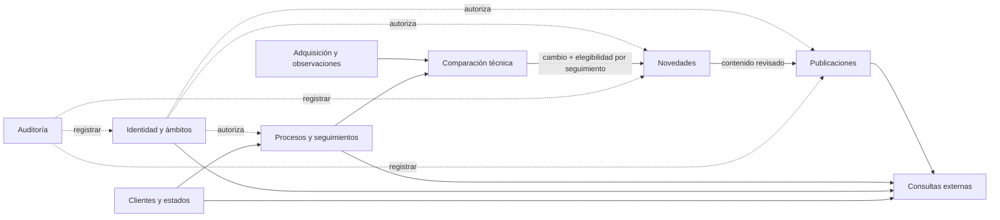

# DOMAIN-001 — Modelo de dominio del backend LegalTech

## 1. Propósito, autoridad y alcance

Este documento define el modelo conceptual y las reglas de dominio necesarias para implementar el escenario de `SCOPE-001` mediante backend persistente. No es un esquema SQL, una especificación OpenAPI ni una decisión de infraestructura. No invalida RF-CAT-001 ni sustituye las máquinas de estado completas de V1.

**Convención de estatus:** `AC` principio previo en fuentes; `SA` alternativa seleccionada por autores sin ratificación organizacional; `PR-F1` diseño candidato que debe aceptarse antes de codificar; `CE` requiere evidencia externa y queda fuera del fixture. Se citan referencias de artefacto y sección para permitir trazabilidad sin declarar requisitos aprobados.

**Escenario demostrativo:** una organización operadora ficticia, clientes Alfa y Beta, proceso radicado `00000000000000000000001`, seguimientos `SEG-A-001` y `SEG-B-001`; primera observación `OBS-001` con `ACT-01..05`; segunda `OBS-002` con `ACT-01..06`; diferencia `ACT-06` y novedad privada `NOV-A-001` exclusiva para A; revisión analista/abogado; publicación `PUB-A-001` v1 autorizada por otra persona; accesos externos por ámbito; denegaciones ante suspensión de cliente y finalización de seguimiento. Fixture adicional `SEG-A-002` sin ámbito de cuenta A prueba denegación entre seguimientos del mismo cliente.

**Fuera del incremento:** consultas judiciales reales, scraping, servicios LLM, OCR/nativo independientes, documentos reales, PDF, informes mixtos, correo, scheduler, rectificación completa, tareas y cierre jurídicos completos. Estos elementos pueden existir como conceptos de evolución, pero no se implementan por anticipación.

## 2. Lenguaje ubicuo

| Término | Definición inequívoca | No confundir con |
|---|---|---|
| Organización operadora | Entidad jurídica que usa la plataforma para gestionar a sus clientes | Cliente destinatario |
| Cliente | Organización que contrata o recibe servicio de seguimiento | Cuenta de usuario |
| Cuenta externa | Principal autenticable vinculado a un solo cliente y ámbitos expresos | Persona natural, cliente, rol |
| Persona | Identidad humana estable asociable a una o más cuentas, clave para segregación | Nombre de usuario de acceso |
| Proceso judicial | Referente judicial común identificado por radicado válido y procedencia | Seguimiento específico |
| Seguimiento | Relación cliente–proceso con ciclo y decisiones propios | Proceso común, fuente |
| Adquisición | Solicitud/intento de consultar una fuente, aquí DEMO-FIXTURE | Observación válida |
| Observación | Instantánea preservada del resultado con fecha, procedencia y calidad | Afirmación de que no hay cambios |
| Actuación | Elemento judicial observado, aquí `ACT-XX` estable solo en fixture | Novedad del cliente |
| Línea base | Primera observación comparable aceptada **por seguimiento** | Primera adquisición intentada |
| Cambio | Diferencia técnica entre dos observaciones comparables, con evidencia | Conclusión jurídica |
| Elegibilidad | Decisión **por seguimiento** de si un cambio debe originar tratamiento | Cambio global por sí solo |
| Novedad | Expediente de tratamiento privado asociado a seguimiento y cambio elegible | Actuación, cambio, publicación |
| Valoración jurídica | Juicio registrado por rol abogado con evidencia | Resultado de comparador o LLM |
| Publicación | Contenedor lógico de comunicaciones y versiones del seguimiento | Versión exacta o entrega efectiva |
| Versión | Contenido/destinatario congelables con estado de autorización propio | Borrador editable sin trazas |
| Disponibilidad externa | Posibilidad de lectura **actual** conforme a publicación + política de autorización | Estado interno Publicada aislado |
| Brecha de cobertura | Intervalo no verificable por adquisición fallida/incompleta o pausa | Confirmación de ausencia de cambios |

## 3. Mapa de contextos y ownership

> Bounded contexts **lógicos candidatos**; su materialización en paquetes o módulos se define en ARCH-001. No se afirman servicios ni esquemas físicos.

| Contexto | Propietario de reglas/datos | Entradas | Salidas/colaboraciones | RF representativos |
|---|---|---|---|---|
| CTX-ID | Identidad, persona, cuenta interna/externa, permisos y ámbito | Solicitud y principal autenticado | Decisión de autorización por operación | 001,005,009,010,114 |
| CTX-CLI | Cliente, estado y eventos de suspensión | Acción interna autorizada | Bloqueo temporal de acceso y adquisiciones propias | 006,008 |
| CTX-SEG | Proceso compartido, seguimiento por cliente, ciclo y baseline | Alta proceso/seguimiento; observación elegible | Estado de vigilancia, referencia por seguimiento | 011,015,016,021–023 |
| CTX-OBS | Petición, ejecución DEMO-FIXTURE, observación, procedencia/cobertura, actuaciones | Fixture o fallo identificado | Instantánea inmutable y validez técnica | 028,032,033,040–042,045,046 |
| CTX-CMP | Comparabilidad, diferencias técnicas e idempotencia | Par ordenado de observaciones válidas | Cambio(s) técnicos y evidencias | 047–055 |
| CTX-NOV | Elegibilidad asociada a seguimiento, novedad, revisión operativa, valoración jurídica | Cambio + seguimiento activo, revisión humana | Estado de tratamiento y contenido validado | 054–059,062,065–069 |
| CTX-PUB | Borrador, versión, preparadores, autorización, emisión y vigencia | Tratamiento validado y destinatario | Versión publicada o rechazo | 120–122,125–129,134 |
| CTX-PORTAL | Casos de consulta externos; compone proyecciones sin poseer la verdad del dominio | Principal externo, seguimiento y publicación | Solo datos autorizados o denegación | 138,140,142–146 |
| CTX-AUD | Evento de auditoría de acciones sensibles y denegaciones | Actores y resultado de casos de uso | Bitácora consultable internamente | 110,114 |

**Fronteras esenciales:**
1. CTX-OBS y CTX-CMP pueden operar sobre un proceso judicial compartido; **no adquieren propiedad de una novedad privada**.
2. CTX-SEG determina baseline/elegibilidad por cada seguimiento; CTX-NOV conserva el expediente privado. Si se reutiliza un cambio técnico, no se reutiliza su tratamiento.
3. CTX-PUB autoriza la versión exacta; CTX-PORTAL nunca decide que un borrador «parece público» por su contenido.
4. CTX-ID aporta permisos y ámbitos; cada caso de uso aplica también políticas actuales de cliente, seguimiento, versión y estado. El frontend no es punto de control de seguridad.
5. CTX-AUD es transversal, pero no sustituye registros de decisión de cada agregado ni crea una infraestructura de eventos distribuida por sí mismo.

### 3.1 Context map: dependencia de reglas



Flechas de colaboración son conceptuales; no especifican llamadas de red ni transacciones físicas.

## 4. Entidades y objetos de valor conceptuales

| Elemento | Naturaleza | Identidad/propiedad | Relación y responsabilidad |
|---|---|---|---|
| Persona | Entidad | `personaId` estable | Puede respaldar varias cuentas; permite evitar autoaprobación por alias |
| Cuenta | Entidad | `cuentaId`, referencia a persona | Interna o externa; activa/deshabilitada; externa vinculada a **un** cliente |
| Ámbito de cuenta | Relación de acceso | `(cuenta, seguimiento, permiso)` conceptual | Se concede/revoca explícitamente; nunca incluye seguimiento de otro cliente |
| Cliente | Entidad/agregado candidato | `clienteId` | Estado Activo/Suspendido y eventos motivados |
| Proceso judicial | Entidad compartida | `procesoId`; `radicado` 23 dígitos sintéticos | Puede tener n seguimientos de diferentes clientes |
| Seguimiento | **Agregado candidato** | `seguimientoId`, `clienteId`, `procesoId` | Estado, referencia basal, elegibilidad y reglas de cierre |
| Solicitud/Intento adquisición | Entidad/registro | `intentoId`, fuente fixture | Resultado, hora, causa, identidad de la solicitud, reintento |
| Observación | Registro inmutable | `observacionId`, `procesoId`, procedencia | Contenido, completitud, `observedAt`; observaciones conservadas |
| Actuación observada | Registro/VO | `(observacionId, claveActuacion)` | En fixture ACT-XX; no crea identidad global judicial verdadera |
| Referencia de línea base | Parte del seguimiento | Seguimiento → observación aceptada | Primera comparable no produce novedades históricas |
| Resultado de comparación | Registro inmutable | `comparacionId`, par ordenado de observaciones | Resultado comparable/indeterminado, algoritmo/reglas y evidencias |
| Cambio técnico | **Agregado candidato** | `cambioId`, clave lógica de diferencia | Tipo `INCORPORACION` en fixture; evidencia y par comparado; no cliente privado |
| Elegibilidad de cambio | Decisión por seguimiento | `(seguimientoId, cambioId)` conceptual | Si procede crear novedad, razones; sin inferencia por compartir proceso |
| Novedad | **Agregado candidato** | `novedadId`, `(seguimientoId,cambioId)` | Estado y revisiones privadas de cliente |
| Revisión operativa | Registro histórico | Identidad actor, evidencia, fecha | Hechos y decisión; no concluye efectos jurídicos |
| Valoración jurídica | Registro histórico | Identidad abogado, novedad, evidencia | Conclusión de ejemplo; no es dictamen real |
| Publicación | **Agregado candidato** | `publicacionId`, seguimiento, destinatario | Ciclo de versiones y cuál es vigente, si existe |
| Versión de publicación | Entidad de publicación | `(publicacionId,versionNo)` | Texto exacto, destinatario, hash/sello conceptual, preparadores, aprobación |
| Entrega/publicación local | Registro de resultado | `publicacionIntentoId` | Confirmación de disponibilidad local/fallo con idempotencia |
| Evento de auditoría | Registro append-only lógico | `eventoId` | Quién, qué, cuándo, recurso, resultado, correlación; no «inviolable» |

**No son tablas todavía.** En Fase 3 se decidirán claves, índices, normalización, restricciones e incluso el límite exacto de cada agregado. La clave estable `ACT-XX` es **solo** del fixture.

### 4.1 Cardinalidades conceptuales

- Organización operadora `1—N` clientes y `1—N` cuentas internas; el incremento asume una sola organización operadora.
- Cliente `1—N` seguimientos; proceso judicial `1—N` seguimientos. Cada seguimiento corresponde a **un cliente y un proceso**.
- Cliente `1—N` cuentas externas; cuenta externa `N—1` cliente; cuenta externa `N—M` seguimientos **únicamente de su cliente**, vía ámbito explícito.
- Proceso judicial `1—N` observaciones; observación `1—N` actuaciones observadas; intentos pueden resultar sin observación comparable.
- Seguimiento `0..1` baseline vigente y potencial historial de referencias; no se modifica la observación original.
- Dos observaciones ordenadas `→` cero o más cambios técnicos; cambio elegible `→` cero o una novedad por seguimiento y clave lógica.
- Novedad `1—N` decisiones/revisiones históricas.
- Publicación `1—N` versiones; publicación `0..1` versión vigente; versión `N—M` personas preparadoras y `0..1` aprobación de esa versión.

### 4.2 Semántica de identidad del proceso

Para fixture: la cadena de 23 dígitos se conserva como **texto** (ceros iniciales), no como número. El origen y la calidad de identidad judicial real pertenecen al problema de integración V1; no se presume unicidad global infalible por un dato sin verificar. En el escenario, un único radicado representa inequívocamente el proceso compartido.

## 5. Agregados, consistencia y responsabilidades de escritura (candidatos)

| Agregado | Comandos de negocio candidatos | Invariantes protegidos en operación | Concurrencia/consistencia sugerida |
|---|---|---|---|
| Cliente | Suspender/Reactivar | Estado actual y bloqueo externo, evento motivado | Fuerte en cambio de estado |
| Seguimiento | Crear/Activar/EstablecerBaseline/Finalizar | Pertenece a cliente y proceso, baseline por seguimiento, cierre sin borrado | Fuerte por seguimiento |
| Observación | IncorporarResultado | Proceso, procedencia, completitud, inmutabilidad | Registro atómico de resultado + evidencia técnica |
| Comparación | CompararPar | Par comparable, no doble cambio lógico, evidencia | Idempotencia y unicidad lógica |
| Novedad | Generar/Revisar/Escalar/Valorar | Una por `(seguimiento,cambio)` elegible, revisión no implícita | Fuerte en creación/transición |
| Publicación | CrearVersión/Someter/Aprobar/Publicar | Versión exacta, preparación ≠ aprobación, máximo una vigente | Fuerte por publicación/versionado |
| Ámbitos | Conceder/Revocar | Denegar por defecto y pertenencia al mismo cliente | Aplicación inmediata en consultas posteriores |

El **ownership** anterior es propuesto. No imponer que una transacción abarque toda la cadena adquisición→publicación: son acciones distintas con trazabilidad. Tampoco introducir saga distribuida sin infraestructura que la requiera.

## 6. Reglas de negocio y invariantes

| ID | Regla comprobable | Fuente / evidencia prevista | Estado |
|---|---|---|---|
| DOM-R01 | Un proceso común nunca concede visibilidad cruzada de seguimientos, novedades o publicaciones. | SCOPE INV-01, RF-DEC §3; AT-12 | AC/SA |
| DOM-R02 | Cada cuenta externa está asociada a un único cliente y a ámbitos explícitos; ausencia de ámbito = denegación. | DEC-01/02, AT-17 | AC/SA |
| DOM-R03 | Todo acceso protegido verifica en backend identidad activa, permisos, pertenencia, ámbito, estado de cliente, seguimiento y publicación. | RF-V1-010/134; AT-12/13/14/17 | AC/SA |
| DOM-R04 | Un cliente suspendido bloquea sus lecturas externas ordinarias, sin borrar datos ni cambiar otros clientes. | DEC-03; AT-13 | SA |
| DOM-R05 | Un seguimiento finalizado no es legible externamente; no cambia automáticamente a Retirada las publicaciones. | DEC-04; AT-14 | SA |
| DOM-R06 | Baseline es la primera observación comparable **aceptada por seguimiento**; no genera novedad retrospectiva. | RF-V1-023,046; AT-03 | AC |
| DOM-R07 | Adquisición Fallida/Incompleta no demuestra ausencia de cambios ni actualiza baseline o último punto comparable. | RF-V1-032,042,047; AT-15 | AC |
| DOM-R08 | Solo un par de observaciones comparables y ordenadas produce diferencias confirmadas; cualquier ambigüedad se registra como Indeterminada. | RF-V1-047–049; AT-04 | AC/PR-F1 |
| DOM-R09 | En fixture, incorporación = claves en OBS-nueva menos claves en OBS-anterior; no usar LLM. | RF-V1-049,050; AT-04 | AC |
| DOM-R10 | Una comparación equivalente no duplica el mismo cambio técnico ni sus evidencias lógicas. | RF-V1-053; AT-05 | AC/PR-F1 |
| DOM-R11 | El mismo cambio técnico puede ser evaluado por varios seguimientos, pero no genera la misma novedad en todos. | RF-V1-054–058; AT-06/12 | AC |
| DOM-R12 | Novedad tiene unicidad lógica `(seguimiento, cambio)` en el incremento; entregas repetidas no duplican. | RF-V1-058; AT-06 | AC/PR-F1 |
| DOM-R13 | Revisión operativa verifica hechos; valoración jurídica expresa solo la registra actor abogado habilitado. | RF-V1-059,062,065–069; AT-07/08 | AC |
| DOM-R14 | Interpretaciones comunicadas en muestra requieren valoración jurídica previa; regla conservadora provisional, no DEC-08 ratificada. | DEC-08 PR; AT-08/09 | PR-F1 |
| DOM-R15 | Borrador y versión autorizada son conceptos distintos; versión sometida se congela; cualquier modificación material crea otra versión. | DEC-13, RF-V1-126/128; AT-09/18 | AC/PR-F1 |
| DOM-R16 | Aprobador de misma versión debe ser persona natural diferente de **todos** los preparadores materiales. | DEC-09 PR; AT-10/18 | PR-F1 |
| DOM-R17 | Autorizada no equivale a Publicada; solo la misma versión disponible localmente puede adquirir Publicada. | DEC-13; AT-10/11 | AC/PR-F1 |
| DOM-R18 | Publicar una versión nueva no expone borradores, versiones rechazadas, retiradas o reemplazadas. | RF-V1-128,129,134; AT-09/11 | AC |
| DOM-R19 | La visibilidad externa depende del estado vigente **al consultar**, no del permiso que existía cuando se aprobó. | DEC-01/03/04; AT-12/13/14/17 | AC/SA |
| DOM-R20 | Bitácora registra cambios sensibles, actores, causa y resultado; no se presenta como inmutable criptográfica ni con retención certificada. | RF-V1-110, DEC-16; AT negativos | AC/PR-F1 |
| DOM-R21 | Reinicio y semillas están restringidos a entorno local de desarrollo, con datos exclusivamente sintéticos. | PROTO-001 §6; AT-16 | AC/PR-F1 |
| DOM-R22 | Ausencia de publicación disponible no implica ausencia de novedad ni continuidad de cobertura. | RF-V1-143,146; AT-15 | AC |
| DOM-R23 | Una publicación del incremento solo puede contener información comunicable asociada a seguimiento y destinatario autorizados; se valida el ámbito interno del preparador. | RF-V1-121/122/125, DEC-01; AT-09/12 | AC/PR-F1 |
| DOM-R24 | Se preserva orden temporal y procedencia de observaciones y decisiones; los datos históricos no se reescriben silenciosamente. | RF-V1-045, DEC-10; AT-03/04/18 | AC |

**Relación con Fase 0:** DOM-R01..24 refinan SCOPE INV-01..12 y no reemplazan los 57 RF referenciados por `TRZ-F0-001`; la cobertura V1 continúa parcial.

## 7. Escenarios y casos de uso de dominio

| UC-F0 | Precondición crítica | Poscondición observable | Negativos obligatorios |
|---|---|---|---|
| 01 Identidad y acceso | Principal habilitado + permisos | Decisión contextual calculada en cada operación | Otra cuenta/otro cliente, cuenta deshabilitada, sin ámbito |
| 02 Proceso y seguimiento | Proceso ficticio y cliente permitido | A/B tienen referencias privadas, estado de seguimiento trazable | Duplicación indebida, acceso cruzado, finalizar dos veces |
| 03 Incorporar observación | Fuente DEMO-FIXTURE identificada | OBS válida o resultado fallido explícito; baseline solo si comparable | Fallo, incompleto, observación de otro proceso |
| 04 Comparar/entregar | Par comparable ordenado y seguimiento elegible | Cambio ACT-06 único y NOV-A-001 para A | Reproceso, B con baseline en OBS-002, par inválido |
| 05 Revisar novedad | Novedad pendiente y analista/abogado autorizados | Decisiones humanas y evidencia preservadas | Rol incorrecto, valoración sin evidencia, salto de estado |
| 06 Preparar/aprobar/publicar | Tratamiento válido, destinatario A | Versión v1 fija, aprobador diferente, solo versión publicada visible | Aprobación sin revisión, autoaprobación, edición posterior, fallo local |
| 07 Consulta externa | Cuenta A habilitada con ámbito SEG-A-001 | Lecturas de versión vigente únicamente | Beta, SEG-A-002, cliente suspendido, seguimiento finalizado |
| 08 Reiniciar muestra | Entorno local de demostración | Semilla de datos y estados repetibles | Ruta pública deshabilitada, ejecución en entorno no local |

### 7.1 Secuencia de referencia y comportamiento de Beta

1. Crear proceso y `SEG-A-001`; mantener `SEG-B-001` como seguimiento distinto del mismo proceso.
2. Incorporar `OBS-001` (5 actuaciones). A la adopta como su **primera** línea base: `0` novedades.
3. Incorporar `OBS-002` (6 actuaciones). Comparar `(OBS-001,OBS-002)` y registrar **un** cambio técnico: `INCORPORACION ACT-06`.
4. A ya tenía baseline OBS-001: el cambio es elegible para A. Crear una sola NOV-A-001. Repetir comparación/entrega no duplica.
5. En la ruta de demostración, B establece su **primera** referencia sobre OBS-002. B no tiene novedad histórica retrospectiva por ACT-06. Esta elección del fixture se explicita para resolver la ambigüedad de PROTO-001 §6, y **no define automáticamente toda la política V1 de reutilización de observaciones**.
6. Analista A revisa hechos, abogado registra valoración ficticia, preparador crea v1, aprobador distinto la autoriza y un caso de uso separado la publica localmente.
7. Lectura externa A autorizada por SEG-A-001; B y cuenta A sin SEG-A-002 deben recibir denegación sin contenido; suspensión/finalización cierran acceso externo sin borrar eventos históricos.

## 8. Reglas de comparabilidad, tiempo y errores

**Validez técnica de fixture (PR-F1):** `ObservacionComparable` exige `procesoId` coincidente, fuente DEMO-FIXTURE confiable solo para demo, resultado Exitoso, datos completos para el conjunto de actuaciones, claves ACT-XX únicas/no ambiguas y momento/corte temporal conocido. Dos instantáneas deben poder ordenarse y usar las **mismas reglas/versiones de identidad**. `Incompleta`, `Fallida`, identidad duplicada/ambigua, corte no confiable o cambio de proceso → `Indeterminada/NoComparable` con razón; nunca «sin cambios».

**Cambios:** por cada par comparable ordenado, `Nuevas = claves_nueva - claves_anterior`. La ausencia de clave en nueva no provoca automáticamente `Eliminación` en este incremento; modificaciones y desapariciones requieren semántica por fuente antes de V1.

**Idempotencia semántica candidata (PR-F1):** mismo `(proceso, obsAnterior, obsNueva, versionReglas, tipoCambio, claveACT)` devuelve el mismo cambio lógico; `(seguimiento,cambio)` devuelve misma novedad lógica. Las claves físicas exactas se deciden en DATA-001. Un nuevo par temporal que observe ACT-06 repetida **no** debe crear novedad por mero reenvío; la política de deduplicación inter-pares y correcciones/rectificaciones se documenta como pendiente antes de ampliar el fixture. No afirmar solución universal de identidad jurídica.

**Referencia temporal:** `observedAt` expresa fecha atribuida al dato; `receivedAt` cuando el sistema lo incorporó. Si una observación antigua llega después de una más nueva, no se reescribe silenciosamente la línea base ni se produce un retroceso; se registra incidencia o revisión. La política de backfill real es futura.

**Cobertura:** `UltimoResultado=Fallido` y `UltimaObservacionComparable=OBS-001` pueden coexistir; pantalla/API debe informar brecha sin inferir `SinCambios`. Un listado sin publicaciones comunica `SinPublicacionesDisponibles`, separado de `SinCambiosConfirmados` y `CoberturaNoVerificada`.

## 9. Reglas de autorización de dominio

Propuesta de decisión para solicitudes protegidas:

```
permitir(principal, operacion, recurso, instante_actual) =
  principal.autenticado AND principal.habilitado
  AND permisoRol(principal, operacion)
  AND perteneceAlContextoPermitido(principal, recurso)
  AND (si externo: principal.clienteId == recurso.clienteId)
  AND (si externo: recurso.seguimientoId en ambitosVigentes(principal))
  AND (si externo: clienteActual == Activo)
  AND (si externo: seguimientoActual == Activo)
  AND (si lecturaPublicacionExterna: version == Publicada Y vigente)
  AND reglasEspecificasOperacion(principal, recurso)
```

No tomar IDs enviados por HTTP como autoridad; resolver la vinculación real desde el repositorio. Internos requieren permisos/ámbitos operativos propios aún por concretar (no equivalen a acceso absoluto); el fixture solo usa actores internos permitidos. Registros de auditoría de denegaciones sensibles no deben filtrar datos del recurso ajeno. Una política de `403` versus `404` para ocultación se cerrará en API-001.

## 10. Límites transaccionales y consistencia

| Operación | Debe ser atómica conceptualmente | Comportamiento ante fallo | Evolución futura |
|---|---|---|---|
| Alta seguimiento | Seguimiento y relación cliente/proceso; evitar duplicados según política | No crear relación huérfana | Restricciones físicas en DATA-001 |
| Aceptar primera baseline | Validación comparable + selección de referencia del seguimiento | No crear novedades si baseline no queda confirmada | Control concurrencia por seguimiento |
| Registrar observación | Resultado, procedencia, items y calidad declarada | Incompleta/Fallida explícita, sin resultado «sin cambios» | Adaptadores reales fuera del dominio |
| Comparar par | Resultado y diferencias lógicas idempotentes | No publicar resultado parcialmente como confirmado | Reintentos seguros con unicidad DB |
| Entregar cambio a seguimiento | Comprobar elegibilidad + insertar o recuperar novedad única | No duplicar al reintentar | Control concurrencia por seguimiento+cambio |
| Registrar revisión | Estado + decisión + actor + evidencia en el mismo compromiso | No transición si no hay evidencia | Historial append-only lógico |
| Someter versión | Contenido/destinatario inmutable + estado Pendiente + identidad preparadores | Sin cambio de estado con snapshot incompleto | Hash de contenido/artefacto definitivo |
| Autorizar versión | Guarda jurídica/segregación + aprobación de versión exacta | Permanecer Pendiente o registrar Rechazada según decisión explícita | Firma/validación avanzada fuera de fixture |
| Publicar local | Versión `Autorizada` → `Publicada` y selección de vigente de manera consistente | Error técnico deja `Autorizada` y registra intento fallido, sin visibilidad externa | Entrega asíncrona requerirá confirmación fiable/outbox |
| Suspender/finalizar | Estado + autor/motivo/historial | No borrar histórico ni alterar otro cliente | Concurrencia con consulta debe reevaluar política vigente |

**Definición de publicación efectiva local (PR-F1):** solo existe disponibilidad si la misma versión queda confirmada como `Publicada` y seleccionada como vigente dentro de la base de datos, con lectura del API protegida por la autorización actual. El commit atómico de la nueva selección es el punto de efecto; una mera respuesta UI o `Pendiente` no cuenta. No hace falta ejecutar una petición HTTP a sí mismo dentro de una transacción. Si el paso falla, no hay cambio visible parcial. Esta semántica no satisface todavía publicación fuera de la plataforma.

**Auditoría y rollback:** los eventos de decisiones exitosas se guardan transaccionalmente con el estado que explican. Un rechazo/denegación debe registrarse por una vía que no dependa del rollback del cambio rechazado, evitando que la propia transacción lo borre; el mecanismo se define en ARCH/DATA/SEC. No se prometen garantías de no repudio.

## 11. Diseño de políticas para expansión, sin implementarlas

- `FuenteJudicialPort`: un caso de uso obtiene resultado conceptual de adquisición; DEMO-FIXTURE lo proporciona hoy, conectores reales requerirían autorización, registros de fallos, trazas y comparabilidad propios.
- `AnalisisDocumentalPort`: pertenece a un subdominio diferido. En V1, únicamente un LLM multimodal previamente existente con revisión humana; no crear OCR/extractor propio separado por anticipación.
- `PublicacionPort`: hoy operación local protegida; PDF/anexos, informes y entregas externas requerirán un contrato de artefacto final, confirmación y revocación.
- `Reloj/Ids`: depender de abstracciones mínimas testeables solo cuando ayuden a reproducibilidad; no crear un framework de puertos genérico.

## 12. Casuística de pruebas de dominio — mínimo

| Escenario | Resultado invariante | AT principal |
|---|---|---|
| Primera OBS-001 en A | Baseline, cero novedades | 03 |
| OBS-002 comparada con OBS-001 | Un cambio ACT-06 | 04 |
| Comparación 2 veces / entrega 2 veces | Mismos cambios/novedades lógicas | 05/06 |
| B inicia baseline en OBS-002 | No recibe NOV-A-001 | 06/12 |
| API externa B usa ID A | Denegación sin contenido | 12 |
| Cuenta A sin SEG-A-002 | Denegación aunque pertenezca a A | 17 |
| Cliente suspendido | Denegación sin alteración publicación/otro cliente | 13 |
| SEG-A-001 finalizado | Denegación pese a versión Publicada internamente | 14 |
| Observación fallida | CoberturaNoVerificada, no SinCambios | 15 |
| Borrador sin aprobación | No visible | 09 |
| Persona usa dos cuentas para preparar y aprobar | Rechazo por persona | 10 (+ negativo) |
| Texto modificado tras someter v1 | Nueva versión y nueva autorización | 18 |
| Publicación técnica falla | Permanece Autorizada; no visible | Complementaria |
| Dos intentos concurrentes de entrega | Una novedad como máximo | Complementaria |

Los 18 AT originales se trazan individualmente en `DOM-TRZ-001_v0.1.csv`. Ninguna prueba está ejecutada.

## 13. Riesgos, contradicciones y límites de certeza

1. `SCOPE-001` amplió el prototipo Vue simulado a backend real. Confirmación documental del alcance por autores pendiente.
2. `DEC-08/09` siguen **PR**. Aplicarlas al fixture es salvaguarda de demostración, no ratificación de política jurídica productiva.
3. `ME-01/ME-03/ME-05` completos todavía requieren cotejo: `DOM-ME-001` delimita solo transiciones del primer incremento.
4. La elegibilidad de B sobre OBS-002 y la deduplicación entre comparaciones sucesivas son decisiones de fixture, no solución probada para todas las fuentes.
5. Cuenta interna puede necesitar ámbito por cartera, departamento o asignación: pendiente; el modelo solo presupone actor interno explícitamente autorizado.
6. Vigencia, reemplazo y retirada avanzados, rectificación e informes mixtos permanecen fuera del primer incremento.
7. Estado `Suspendido` de seguimiento de ME-01 tiene política **de visibilidad externa aún pendiente**: el demo no usa ese estado, solo suspensión de cliente y seguimiento Finalizado. No extrapolar.
8. No se han validado permisos de integración real, condiciones legales de datos ni seguridad productiva.

## 14. Definition of Done de Fase 1 y puerta a Fase 2

**Preparado para evaluar arquitectura** si: (a) cada concepto tiene dueño lógico; (b) están fijadas reglas de separación proceso/seguimiento y observación/cambio/novedad; (c) están descritas transiciones y guardas demo; (d) las reglas de autorización externas son comprobables; (e) hay matriz AT → reglas y una lista de pendientes explícitos. Estos artefactos permiten comenzar Fase 2 **como diseño candidato**.

**No está listo para desarrollo por agente** hasta resolver o aceptar formalmente los bloqueos pertinentes del registro `DEC-F1-001`, producir ARCH-001/ADR, DATA-001, API-001, SEC-NFR-001, TEST-001 y los fixtures versionados. Los autores deberán aceptar el subconjunto de reglas propuesto antes de fijarlo como contrato implementable.

## 15. Fuentes internas consultadas

- `SCOPE-001_v0.1.md` §§1–9; `DEC-F0-001_v0.1.md` §§2–4; `BACKLOG-F0-001_v0.1.md` §2; `TRZ-F0-001_v0.1.csv`.
- `HANDOFF_Arquitectura_Backend_LegalTech_v0.1/01_Requisitos/RF-CAT-001_v0.8.md` §§G01–G05, G08–G10 y §16.
- `HANDOFF_Arquitectura_Backend_LegalTech_v0.1/02_Decisiones/RF-DEC-001_v0.4.md` §§2–5 y 13.
- `HANDOFF_Arquitectura_Backend_LegalTech_v0.1/03_Prototipo/PROTO-001_v0.1.md` §§3, 5–9.
- `HANDOFF_Arquitectura_Backend_LegalTech_v0.1/04_Proceso_TO_BE/TOBE-001_Especificacion_y_revision.md` y BPMN-01..04.

**Referencia metodológica:** ISO/IEC/IEEE 29148:2018 (trazabilidad y consistencia), OWASP ASVS 5.0 (autorización comprobable), diagramación conceptual Mermaid y guía C4 reservada para Fase 2. Uso como guías, sin aseverar conformidad certificada.
